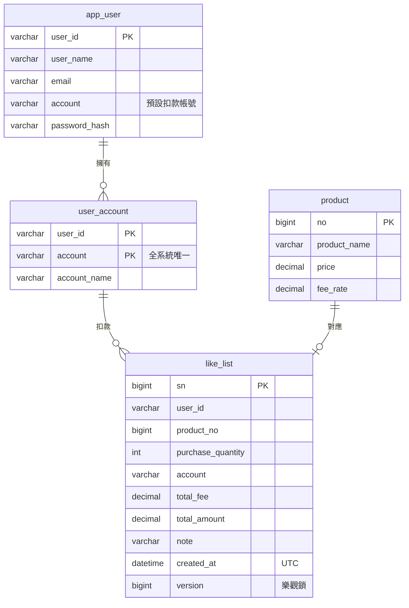

# 系統架構與設計決策

## 系統架構

後端分成 4 層，每層一個套件，都在 `io.github.hsuanc0921.favorites` 底下：

| 層 | 套件 | 責任 |
| --- | --- | --- |
| Presentation | `presentation` | 接收請求、檢查輸入、決定回應格式，並把錯誤換成 HTTP 狀態碼 |
| Business | `service` | 計算手續費與總金額，決定哪些操作要放在同一個交易（`@Transactional`） |
| Data | `repository` | 用 `CALL` 呼叫 Stored Procedure，並把資料庫的錯誤換成業務例外 |
| Shared | `common` | 安全設定、例外與共用的資料類別 |

## 資料模型

- 一個扣款帳號只屬於一位使用者，喜好用到的扣款帳號必須是自己的。
- 每筆喜好各有一筆自己的 Product，新增、修改、刪除時兩邊一起動。
- 價格大於 0，手續費率介於 0 到 1，購買數量介於 1 到 1,000,000，由資料庫的 CHECK 把關。
- 手續費率存成比例，`0.1` 就是 10%，`0.01` 就是 1%，和題目的例子一致，畫面上則用百分比輸入與顯示。
- 金額一律是新台幣，用 `DECIMAL` 存到小數 2 位，不用浮點數。
- 時間以 UTC 存放，由前端轉成本地時間。

建表與 Stored Procedure 的腳本見 [DB/README.md](../DB/README.md)。

## 設計決策

### 為什麼用 Stored Procedure 加 `JdbcClient`，不用 JPA？

題目要求資料存取要走 Stored Procedure。`JdbcClient` 可以直接下 `CALL`，不必再經過 ORM。後端寫出來的 SQL 只有固定的 `CALL` 字串，參數一律用 `?` 綁定，要檢查有沒有 SQL Injection，只要確認這一點。

### 為什麼清單用 `afterSn` 接續，不用頁碼？

翻頁的時候資料可能新增或被刪掉，用頁碼的話，同一筆可能重複出現，也可能被漏掉。改用上一頁最後一筆的 `sn` 往後取，結果就穩定。查詢走 `(user_id, sn)` 索引，直接從上次的位置往後讀，不像 `OFFSET` 要先掃過前面所有資料，翻到很後面也不會變慢。用法見[回應範例](API.md#回應範例)。
