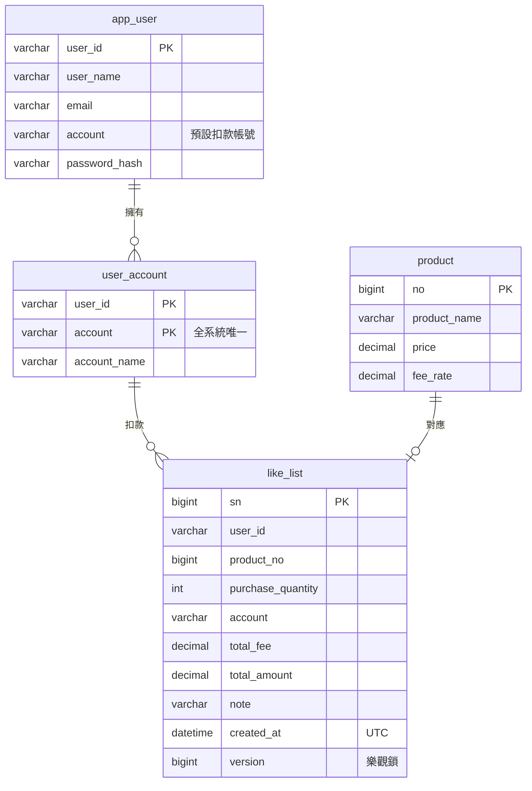

# 系統架構與設計決策

## 資料模型

- 一個扣款帳號只屬於一位使用者，喜好用到的扣款帳號必須是自己的。
- 每筆喜好各有一筆自己的 Product，新增、修改、刪除時兩邊一起動。
- 價格大於 0，手續費率介於 0 到 1，購買數量介於 1 到 1,000,000，由資料庫的 CHECK 把關。
- 手續費率存成比例，`0.1` 就是 10%，`0.01` 就是 1%，和題目的例子一致，畫面上則用百分比輸入與顯示。
- 金額一律是新台幣，用 `DECIMAL` 存到小數 2 位，不用浮點數。
- 時間以 UTC 存放，由前端轉成本地時間。

建表與 Stored Procedure 的腳本見 [DB/README.md](../DB/README.md)。
